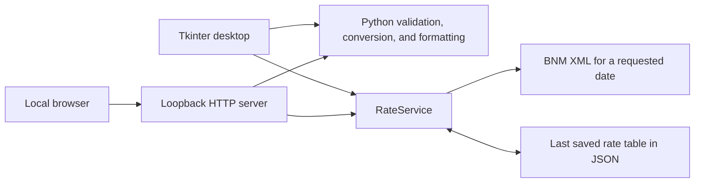
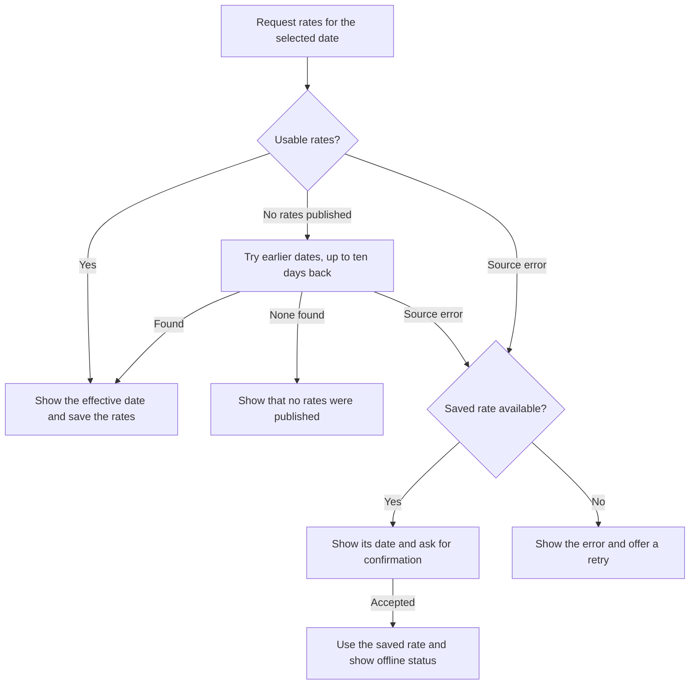

# BNM Currency Converter

Lab 3 uses the official exchange rates of the National Bank of Moldova (BNM).
The Tkinter desktop app and the local browser app support MDL and around 40
foreign currencies. Both use the same Python core and offer the last saved
rates when the source is unavailable.

## Run

Use Python 3.11 or newer. The desktop app also needs Tkinter, which is included
in the standard Windows Python installer. Both apps use the Python standard library.

```sh
python -m currency_converter       # Tkinter desktop app
python -m currency_converter.web   # Browser app
```

Open [the local web app](http://127.0.0.1:8000) after starting the web command.
Enter an amount, choose a currency pair, and convert with the button or Enter.
You can swap currencies, choose a date in DD.MM.YYYY format, reset it to today,
or refresh the rates for that date. Each result includes both directions of the
rate, its effective date, and the source.

## Architecture



The [BNM XML endpoint](https://www.bnm.md/ru/official_exchange_rates) publishes
quotes in MDL per stated nominal. For example, the JPY quote applies to 100 yen.
The converter divides by the nominal and uses `Decimal` for cross-rates through MDL.

## How the app selects a rate



## Unit tests

```sh
python -m venv .venv
# Activate .venv with .venv\Scripts\Activate.ps1 on PowerShell
# or source .venv/bin/activate on Linux and macOS.
python -m pip install -r requirements-dev.txt
python -m pytest
```

The unit suite uses local fixtures and temporary cache files. It does not contact BNM.

## Configuration

| Environment variable | Effect |
| --- | --- |
| `CURRENCY_CONVERTER_HOME` | Directory for `rates_cache.json`. The default is `%APPDATA%\CurrencyConverter` on Windows or `$XDG_DATA_HOME/currency-converter` on Linux and macOS, falling back to `~/.local/share/currency-converter`. |
| `CURRENCY_CONVERTER_SOURCE_URL` | Base URL of the BNM XML source. Set it to `http://127.0.0.1:9/` to demonstrate offline recovery, then remove the override to restore live loading. |

The [original specification](specs/001-currency-converter/spec.md),
[interface follow-up](specs/002-web-ui/spec.md), and [lab report](REPORT.md)
document the requirements and development process.
